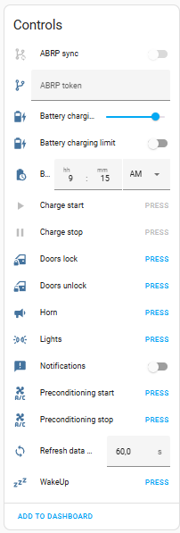
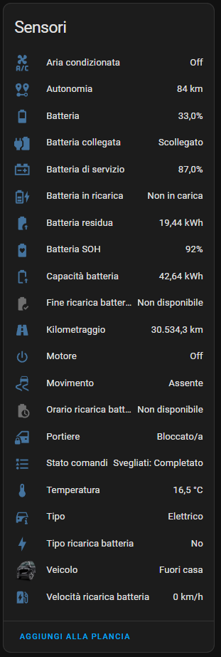
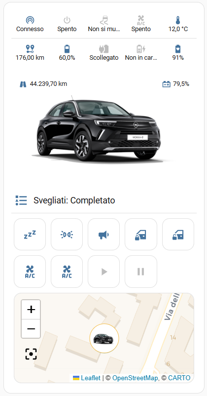

# HomeAssistant - Stellantis Vehicles
[](#)  
[](#)

- [Installation](#installation)
- [Screenshot](#screenshot)
  - [Vehicle Card](#vehicle-card)
- [Card: Stellantis Vehicles](#card-stellantis-vehicles)
- [Global preferences](#global-preferences)
- [ABRP - A Better Routeplanner](#abrp---a-better-routeplanner)
- [Contributors & Translations](#contributors--translations)
- [Support the project](#support-the-project)

|                                  | Brand | Credits |
|----------------------------------|-------|---------|
| [Details](./docs/PSA.md)         |      | Inspired by [PSA Car Controller](https://github.com/flobz/psa_car_controller) (OTP step its a fork). Thanks to [Florian BEZANNIER](https://github.com/flobz) for his great work |
| [Details](./docs/LEAPMOTOR.md)   |  | Cloud protocol from [kerniger/leapmotor-ha](https://github.com/kerniger/leapmotor-ha) (MIT) and [markoceri/leapmotor-api](https://github.com/markoceri/leapmotor-api), app certificate from [markoceri/leapmotor-certs](https://github.com/markoceri/leapmotor-certs). Thanks to [@kerniger](https://github.com/kerniger) and [@markoceri](https://github.com/markoceri) for their great work |

## Installation
<details><summary><b>Using HACS</b></summary>

1. Go to [HACS](https://hacs.xyz/) section;
2. Search and install **Stellantis Vehicles** from the HACS integration list;
3. Add this integration from the **Home Assistant** integrations.

</details>
<details><summary><b>Manually</b></summary>

1. Download this repository;
2. Copy the directory **custom_components/stellantis_vehicles** on your Home Assistant **config/custom_components/stellantis_vehicles**;
3. Restart HomeAssistant;
4. Add this integration from the **Home Assistant** integrations.

</details>

## Screenshot
### Entities


### Vehicle Card


Documented on [Card: Stellantis Vehicles](#card-stellantis-vehicles) section.

## Card: Stellantis Vehicles
A new custom card is available to manage the vehicle, the card is configurable from the visual editor or via yaml:
```
type: custom:stellantis-vehicle-card
entity: device_tracker.#####VIN#####_vehicle
hide_features: false
features_icons_size: 20
features:
  - binary_sensor.#####VIN#####_remote_commands
  - sensor.#####VIN#####_battery
hide_content: false
content_icons_size: 14
content:
  - sensor.#####VIN#####_temperature
  - sensor.#####VIN#####_last_trip
hide_actions: false
actions:
  - button.#####VIN#####_wakeup
  - button.#####VIN#####_charge_start
hide_charging_limit: false
hide_charging_start: false
hide_map: false
hide_last_trip: false
hide_last_charge: false
```
\* the entity names above are in english, please use your language entity names.

Some users report bugs during first use or after page refresh ([#440](https://github.com/andreadegiovine/homeassistant-stellantis-vehicles/issues/440), [#441](https://github.com/andreadegiovine/homeassistant-stellantis-vehicles/issues/441)), it seems like a browser or mobile app cache issue.

To reset mobile app cache try: **Settings > app settings > Problem solving > Reset frontend cache**

## Global preferences
These initial choices can be changed in the **Reconfigure** flow under **Global preferences**:
- Enable persistent notifications
- Anonymize personal data on logs

Thanks to the community ([#414](https://github.com/andreadegiovine/homeassistant-stellantis-vehicles/issues/414)), it seems that for some hardware, the "Anonymize personal data on logs" feature makes the environment unstable. It is recommended to disable this feature and enable it only when you need to share logs.

## ABRP - A Better Routeplanner
Get a token from [ABRP](https://abetterrouteplanner.com/):
1. Login to your account;
2. Navigate to vehicle settings;
3. Navigate to real time data;
4. Navigate to edit connections;
5. Generate a token using "Generic" method;

Use the generated token in **abrp_token sensor** and enable **abrp_sync switch** to send updates.

## Contributors & Translations
Start from the "**develop**" branch and submit PRs in that branch.

Commit messages are included as release notes, please keep them short and understandable.

Before each PR please test:
- New installation;
- Reconfiguration;
- Commands;
- Sensors;
- 1 week without errors in logs;

If the checklist is complete, the PR will be merged and will be released a BETA version, if no issues are reported the changes will included on next stable release.

Thanks to all users who contribute to this integration by updating translations and reporting issues.

### Special thanks:
- [@MoellerDi](https://github.com/MoellerDi) for the great work and big support;
- [@benbox69](https://github.com/benbox69) for the python oauth2 helper tool;
- [@khenderick](https://github.com/khenderick) for the great work and big support;
- [@kerniger](https://github.com/kerniger) and [@markoceri](https://github.com/markoceri) for the Leapmotor cloud protocol and app certificate;

Thanks to everyone for the issues, especially to:
- [@chmtc94](https://github.com/chmtc94);
- [@FrankTub](https://github.com/FrankTub);
- [@Jordan87](https://github.com/Jordan87);

## Support the project
**The latest heroes who believe in this project** 👇

**🏆 MONTHLY BEERS**  
Harald  

**🥈 10 BEERS**  
Rüdiger  
Andrea Donno  
Fabian  

**🥉 5 BEERS**  
Someone  
Dieter  
SA Energy  
<sub>*and other heroes*</sub>

**⭐ 4 BEERS**  
Al  

**⭐ 3 BEERS**  
Adam Szczerba  
Hubert  
Someone  
<sub>*and other heroes*</sub>

**⭐ 2 BEERS**  
Ludvik  
Liam  
Kristian  
<sub>*and other heroes*</sub>

**⭐ 1 BEERS**  
Harald  
Someone  
Fritz  
<sub>*and other heroes*</sub>

### Want to join the Club?
[](https://www.buymeacoffee.com/andreatito)  
[](https://ko-fi.com/W7W11C9QJ7)
