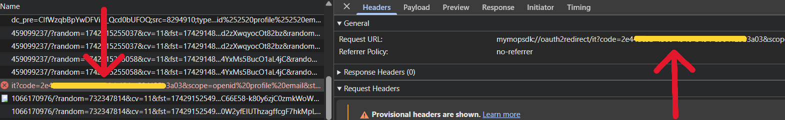
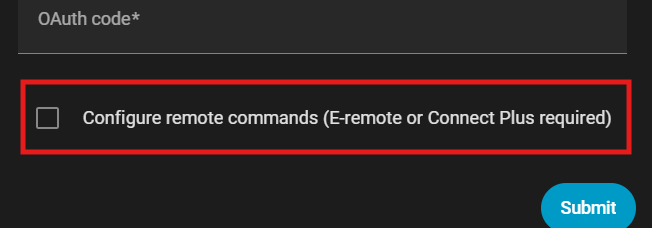
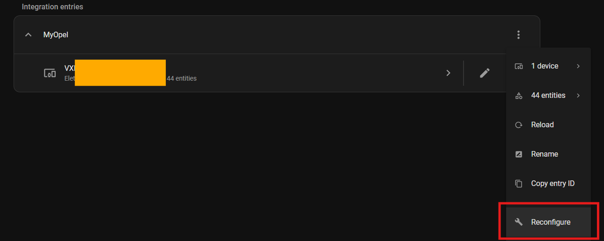

# PSA vehicles (Peugeot, Citroën, DS, Opel, Vauxhall)
[← Back to README](../README.md)

- [Requirements](#requirements)
- [Features](#features)
- [OAuth2 Code](#oauth2-code)
- [Commands](#commands)
  - [WakeUp](#wakeup)
  - [Air conditioning Start/Stop](#air-conditioning-startstop)
- [Battery capacity / residual sensors](#battery-capacity--residual-sensors)
- [Errors](#errors)
  - [OTP error - NOK:MAXNBTOOLS](#otp-error---nokmaxnbtools)
  - [OTP error - NOK:NOK_BLOCKED](#otp-error---noknok_blocked)
  - [Get oauth code error](#get-oauth-code-error)
  - [Command status 901 and 300 - Wakeup timeout](#command-status-901-and-300---wakeup-timeout)

| Peugeot                               | Citroën                               | DS                          | Opel                            | Vauxhall                                |
|---------------------------------------|---------------------------------------|-----------------------------|---------------------------------|-----------------------------------------|
|  |  |  |  |  |

**Inspired by [PSA Car Controller](https://github.com/flobz/psa_car_controller) (OTP step its a fork). Thanks to [Florian BEZANNIER](https://github.com/flobz) for his great work**

## Requirements
Get status:
- **Vehicle native mobile app** installed and active;
- **Use a pc for autentication**;

Send remote commands:
- Get status requirements;
- **Remote service** actived (E-remote or Connect Plus);

> Currently Stellantis not provide B2C api credentials, this integration use the mobile apps api credentials and login flow.

## Features
|                            | Electric / Hybrid | Thermic | E-remote control | Remote control  | Connect Plus |
|----------------------------|:-----------------:|:-------:|:----------------:|:---------------:|:------------:|
| Get status                 |        ✔️         |   ✔️    |        ✔️        |                 |      ✔️      |
| Wake up                    |        ✔️         |   ✔️    |        ✔️        |                 |      ✔️      |
| ABRP sync                  |        ✔️         |   ✔️    |        ✔️        |                 |      ✔️      |
| Preconditioning start/stop |        ✔️         |   ✔️    |        ✔️        |                 |      ✔️      |
| Doors open/close           |        ✔️         |   ✔️    |                  |       ✔️        |      ✔️      |
| Flash lights               |        ✔️         |   ✔️    |                  |       ✔️        |      ✔️      |
| Honk the horn              |        ✔️         |   ✔️    |                  |       ✔️        |      ✔️      |
| Charging start/stop        |        ✔️         |         |        ✔️        |                 |      ✔️      |
| Charging limit             |        ✔️         |         |        ✔️        |                 |      ✔️      |

## OAuth2 Code
### Remote service
This **[remote service](https://github.com/andreadegiovine/homeassistant-stellantis-vehicles-worker-v2)** simulates a browser login session on the official website to authenticate your account.

<ins>**Your credentials are neither stored nor shared**</ins>

The service is provided by Render.com on a free tier, with performance limitations.

> If you want to support the project and extend these limits, <ins>become a hero</ins> and join our **monthly [supporters club](../README.md#support-the-project)**!

If you'd rather not depend on the shared Render.com instance, you can self-host the
[worker](https://github.com/andreadegiovine/homeassistant-stellantis-vehicles-worker-v2) and enter
its URL in the "Login service URL" field of the config flow's remote-login step instead of the
default one.

### Manual
<details><summary><b>Using browser console</b></summary>

As described on config flow, please get the right code from the mobile app redirect like this example (Chrome browser):



</details>
<details><summary><b>Using python tool</b></summary>

Thanks to [@benbox69](https://github.com/benbox69) for creating this awesome Python tool to fetch oauth code without using browser console: [stellantis-oauth-helper](https://github.com/benbox69/stellantis-oauth-helper)

</details>
<details><summary><b>Using external service</b></summary>

Thanks to [@benbox69](https://github.com/benbox69) for creating this awesome external service to fetch oauth code without using browser console: [OAuth Code Extractor](https://github.com/andreadegiovine/homeassistant-stellantis-vehicles/discussions/378)

</details>

## Commands
To use remote commands, the "E-remote" or "Connect Plus" service must be activated and configured in the vehicle.

How to complete the OTP step and activate remote commands:
<details><summary><b>New configuration</b></summary>



</details>
<details><summary><b>Existing configuration</b></summary>



</details>

### WakeUp
For some vehicles no updates are received a few minutes after the engine is turned off. Use automations like these to schedule the vehicle wake up:

```yaml
- id: "standby_wakeup"
  alias: Vehicle standby WakeUp (every 1 hour)
  description: ""
  mode: single
  triggers:
    - trigger: time_pattern
      hours: /1
  conditions:
    - condition: state
      entity_id: binary_sensor.#####VIN#####_battery_charging
      state: "off"
  actions:
    - action: button.press
      metadata: {}
      data: {}
      target:
        entity_id: button.#####VIN#####_wakeup
```

```yaml
- id: "charging_wakeup"
  alias: Vehicle charging WakeUp (every 5 minutes)
  description: ""
  mode: single
  triggers:
    - trigger: time_pattern
      minutes: /5
  conditions:
    - condition: state
      entity_id: binary_sensor.#####VIN#####_battery_charging
      state: "on"
  actions:
    - action: button.press
      metadata: {}
      data: {}
      target:
        entity_id: button.#####VIN#####_wakeup
```
\* the entity names above are in english, please use your language entity names.

<ins>**Some users report that performing too many wakeups drains the service battery, making some features unavailable (such as keyless entry)**</ins>.

### Air conditioning Start/Stop
As described in the Stellantis apps, the command is enabled when:
1. The vehicle engine is off;
2. The vehicle doors are locked;
3. The battery level is at least ~~50% (20% for hybrids)~~ 20% or in charging ([#226](https://github.com/andreadegiovine/homeassistant-stellantis-vehicles/issues/226));

## Battery capacity / residual sensors
Thanks to the community ([#272](https://github.com/andreadegiovine/homeassistant-stellantis-vehicles/issues/272)), it seems that for some vehicles **Stellantis provides incorrect values**. The **switch.battery_values_correction** entity (in your language) applies a correction if active.

\*currently only to the battery_residual sensor

## Errors
<ins>Before any issue request, please check the integration log and look for solution below</ins>.

### OTP error - NOK:MAXNBTOOLS
It seems that this error is due to reaching the limit of associated devices / SMS received. Restore your Stellantis account and try again:
[Follow this procedure from Peugeot community](https://peugeot.my-customerportal.com/peugeot/s/article/AP-I-have-problems-with-the-pin-safety-code-or-I-want-to-change-it-What-can-I-do?language=en_GB).

<ins>**This operation removes the devices connected to your vehicle, no vehicle data will be lost**</ins>.

### OTP error - NOK:NOK_BLOCKED
It seems that this error is due to reaching the limit of wrong PIN used. Re-authenticate the integration.

### Get oauth code error
As described in the "OAuth2 Code > [Remote service](#remote-service)" section, this free service has usage limitations.  
If you've hit these limits, please wait and try again.  
If the problem persists or is unrelated to usage limits, please use "OAuth2 Code > [Manual](#manual)" mode.

### Command status 901 and 300 - Wakeup timeout
**901 (Wakeup Vehicle)** is the wakeup command being forwarded from the Stellantis backend to your vehicle, it doesn't say anything about the vehicle's state by itself. If it's followed by **300 (Timeout)** instead of **0 (Complete)**, the vehicle didn't respond, which means it's in a deep sleep.

Stellantis disables connectivity to protect the 12V battery, the vehicle apps explain it like this:

> Your vehicle has not been used for more than 15 consecutive minutes in the last 7 days. To preserve your 12V battery, connectivity is disabled.

This is tracked per vehicle, not per integration: any trip shorter than 15 minutes doesn't count, no matter how close it gets. If all your trips in the last 7 days were under 15 minutes, connectivity gets disabled and every wakeup times out until a trip passes the threshold again.

To avoid repeated timeouts, take at least one trip longer than 15 minutes every 7 days.
